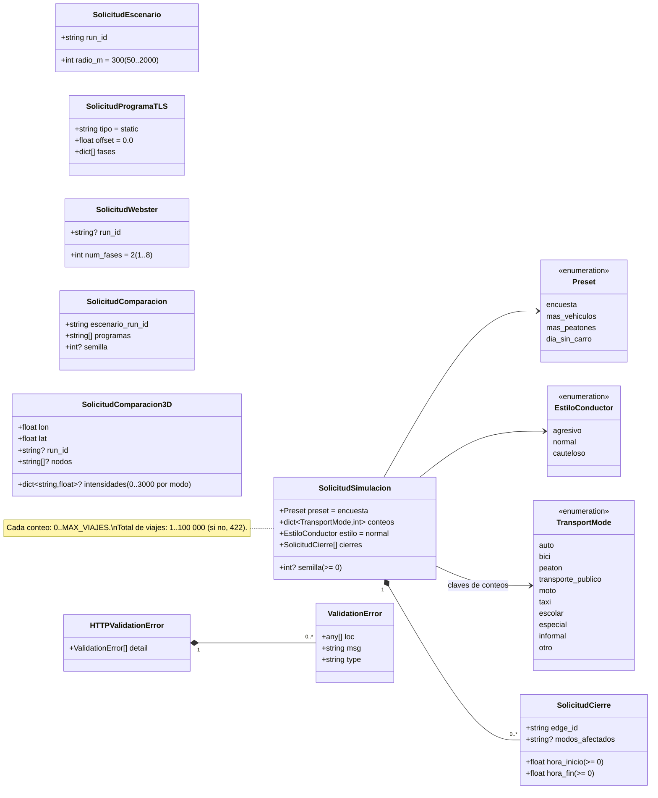
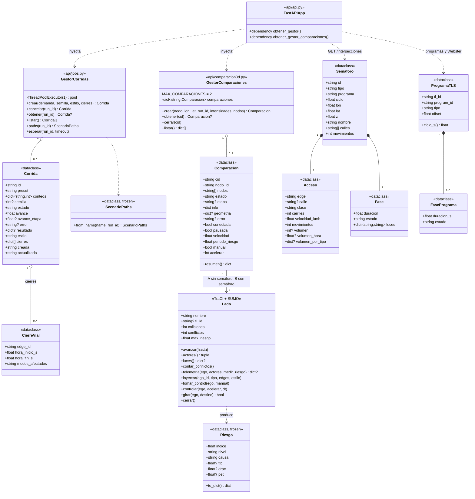

# API de `simulation-service`: diagramas de clases

La documentación OpenAPI completa de la API (26 rutas, FastAPI 0.136.3) está en [`openapi.json`](openapi.json). Se generó con `app.openapi()` desde `simulation-service/src` (`from api.api import app`). La API viva la publica en `/docs` y `/openapi.json`.

Para regenerarla, desde `simulation-service/` con el venv activo:

```bash
python -c "import json; from api.api import app; json.dump(app.openapi(), open('../docs/api/openapi.json', 'w'), indent=2, ensure_ascii=False)"
```

El OpenAPI solo describe los cuerpos de **entrada** (modelos Pydantic). Los endpoints devuelven `dict`, así que sus respuestas no tienen esquema en el JSON. Por eso el diagrama 2 se armó leyendo el código.

## 1. Esquemas de la API (OpenAPI)

Modelos Pydantic de `api/api.py` y los enumerados que usan. Las flechas son referencias entre esquemas.



### Rutas por grupo

| Grupo | Rutas | Cuerpo de entrada |
|---|---|---|
| Corrida por defecto | `GET /health`, `GET /simulation-output`, `GET /kepler-trips` | — |
| Demanda | `GET /demanda/modos`, `/demanda/presets`, `/demanda/estilos` | — |
| Corridas | `POST /simulaciones` (202), `GET /simulaciones`, `GET /simulaciones/{run_id}`, `POST /simulaciones/{run_id}/cancelar` (202), `GET /simulaciones/{run_id}/kepler-trips` | `SolicitudSimulacion` en el POST |
| Precalculadas | `GET /precalculadas`, `GET /precalculadas/{preset}/kepler-trips` | — |
| Intersecciones | `GET /intersecciones`, `/intersecciones/priorizacion`, `/intersecciones/{tl_id}` | — |
| Zonas y programas | `POST /intersecciones/{tl_id}/escenarios` (202), `GET /escenarios/{run_id}`, `GET /intersecciones/{tl_id}/programas[/{program_id}]`, `PUT .../programas/{program_id}`, `POST .../programas/webster` | `SolicitudEscenario`, `SolicitudProgramaTLS`, `SolicitudWebster` |
| Comparación de programas | `POST /intersecciones/{tl_id}/comparaciones` (202), `GET /comparaciones/{id}` | `SolicitudComparacion` |
| Simulador 3D | `POST /cruces/{nodo_id}/comparacion3d` (202), `GET /comparacion3d`, `GET /comparacion3d/{cid}`, `GET .../geometria`, `DELETE /comparacion3d/{cid}` (204), `WS /comparacion3d/{cid}` | `SolicitudComparacion3D` |

El WebSocket no aparece en el OpenAPI (OpenAPI no describe WebSocket). Sus comandos de entrada son `pausa`, `velocidad`, `periodo_riesgo`, `control`, `seguir`, `inyectar`, `manual` y `giro`.

## 2. Clases del servidor

Clases que implementan la API: los gestores de `api/jobs.py` y `api/comparacion3d.py`, y las estructuras de `etl/sumo/` que se devuelven como JSON. Solo se muestran los atributos y métodos principales.



### Notas

- `GestorCorridas` ejecuta una corrida a la vez (`ThreadPoolExecutor(1)`) y guarda cada `Corrida` en `runs/<id>/estado.json`. Los estados son `en_cola`, `generando_demanda`, `ruteando`, `simulando`, `exportando`, `cancelando`, `terminado`, `error` y `cancelada`.
- `GestorComparaciones` rechaza con 429 la tercera comparación simultánea. Cada `Comparacion` abre dos `Lado` (dos procesos SUMO en lockstep) solo cuando se conecta el WebSocket.
- `Lado` está en la clase `Comparacion` solo de forma conceptual: se crea en el hilo que ejecuta `correr_comparacion`, no es un campo del dataclass.
- Los gestores se inyectan con `Depends`, y las pruebas los reemplazan con `app.dependency_overrides`.
