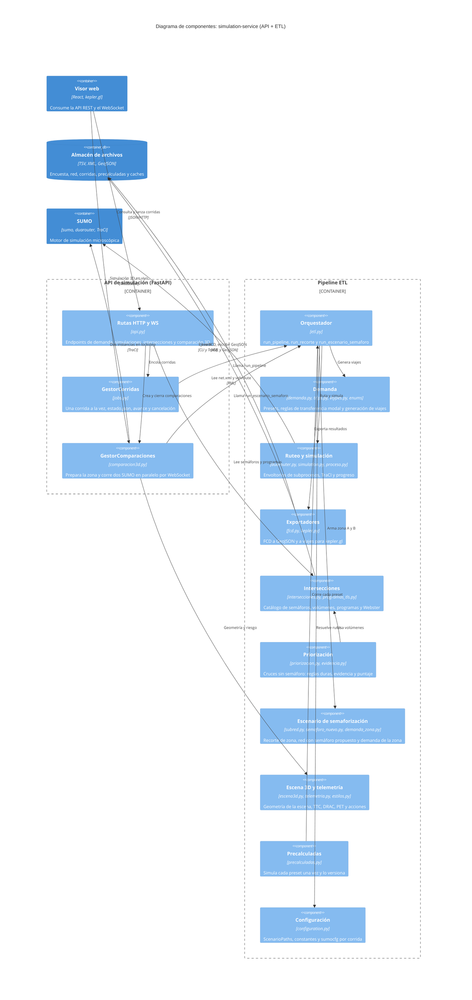
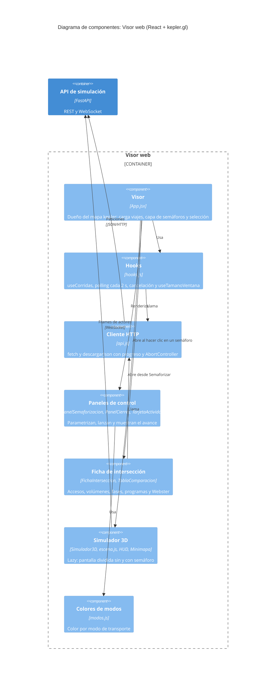
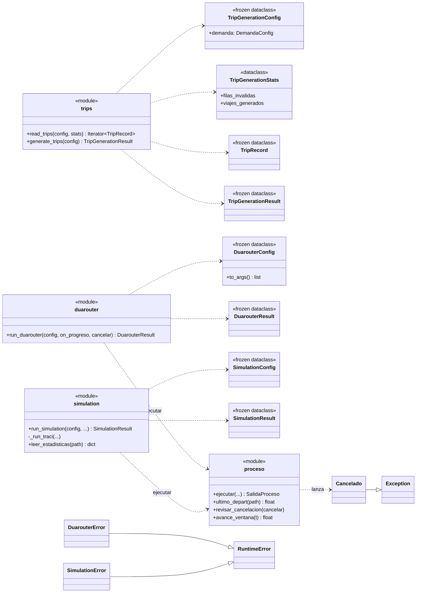
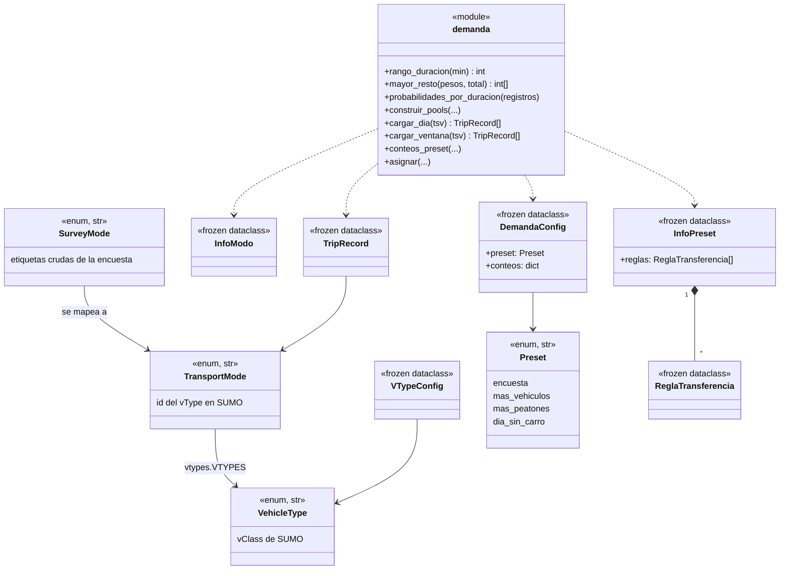
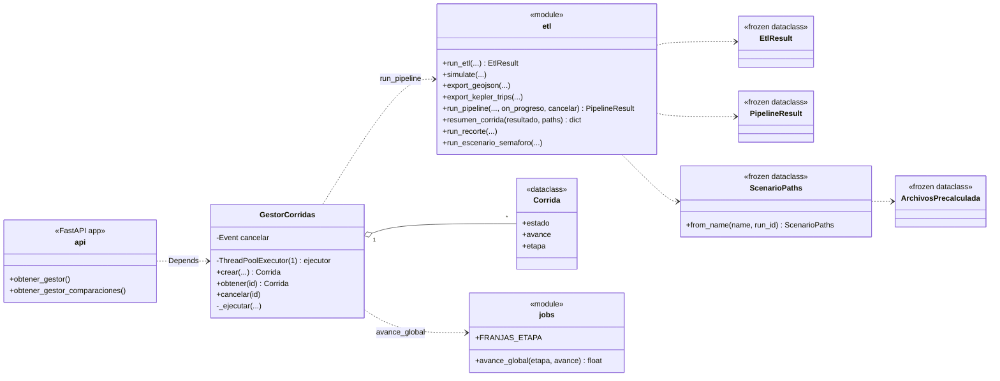
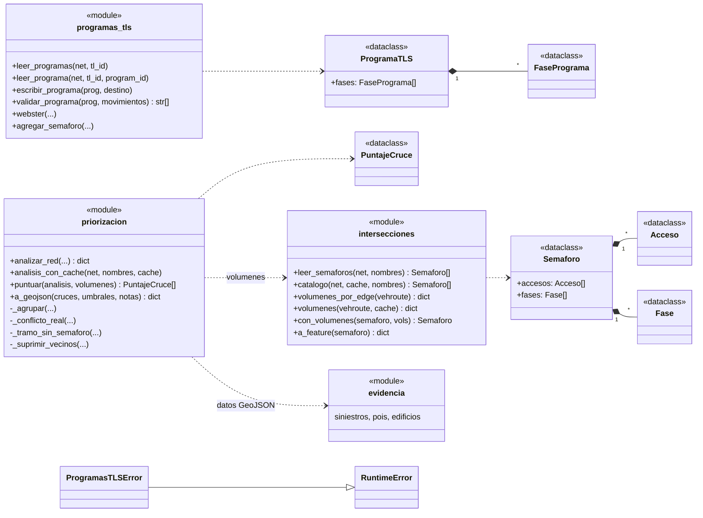
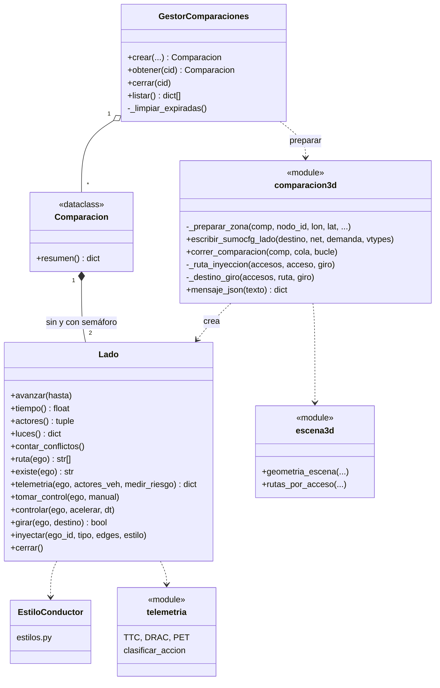

# Modelo C4: niveles 3 (Componentes) y 4 (Código)

Complementa `tesis.drawio`, `tesis-c4-context.svg` y `tesis-c4-container.svg`. Los diagramas están en Mermaid, que GitHub, GitLab, VS Code y Obsidian renderizan. Los nombres de módulos, clases y funciones salen del código en `simulation-service/src/` y `kepler/src/`.

Contenedores de partida (nivel 2):

| Contenedor | Tecnología | Carpeta |
|---|---|---|
| Visor web | React, Vite, kepler.gl, three.js | `kepler/` |
| API de simulación | FastAPI | `simulation-service/src/api/` |
| Pipeline ETL | Python | `simulation-service/src/etl/` |
| SUMO | `sumo`, `duarouter`, TraCI | pip `eclipse-sumo` |
| Almacén de archivos | TSV, XML, GeoJSON | `data/`, `scenarios/`, `runs/`, `precalculadas/`, `cache/` |

> Nota: el C4 estricto no tiene "nivel de capas". Aquí el nivel 3 muestra los componentes de cada contenedor y el nivel 4 muestra las clases, que es el nivel de código.

---

## Nivel 3 — Componentes

### 3.1 Backend: API de simulación y Pipeline ETL

### 3.2 Visor web (`kepler/`)

---

## Nivel 4 — Código

Diagramas de clases de los componentes con más lógica. Las funciones de módulo se dibujan como clases `<<module>>`.

### 4.1 Patrón común de los pasos del pipeline

Cada paso de `etl/sumo/` usa `*Config` (inmutable), `*Stats` (mutable) y `*Result`, como indica el CLAUDE.md.

### 4.2 Demanda parametrizada y mapeo de modos

### 4.3 Orquestación, corridas y progreso

> Los métodos de `GestorCorridas` en este diagrama (`crear`, `obtener`, `cancelar`, `_ejecutar`) están inferidos de su responsabilidad. Verifica los nombres reales en `api/jobs.py`, porque no leí esa clase completa.

### 4.4 Intersecciones y priorización

### 4.5 Comparador 3D (`comparacion3d.py`)

---

## Cómo mantenerlo

- Si agregas un `TransportMode`, actualiza 4.2 y el color en `kepler/src/modos.js`.
- Si agregas un componente al pipeline, agrégalo en 3.1 y verifica que su archivo exista.
- Mermaid `C4Component` es experimental y su layout es automático. Si necesitas control exacto de posiciones, usa `tesis.drawio` como fuente visual.
